<div align="center">

#  BiteShip

### Distributed, Event-Driven Food Delivery Platform

A production-style food delivery platform inspired by systems such as **Zomato, Swiggy, and Blinkit**, built using a **microservices architecture**, asynchronous messaging, realtime communication, geospatial queries, and role-based workflows.

[]()
[]()
[]()
[]()
[]()
[]()

</div>

---

# 🚀 Overview

**BiteShip** is a distributed food delivery platform designed around the complete lifecycle of an order:

> Customer discovers a restaurant → adds items to cart → selects an address → creates an order → completes payment → restaurant accepts and prepares the order → nearby riders are notified → a rider accepts the delivery → order status is updated in realtime → customer tracks the delivery → order is delivered.

The project focuses heavily on **backend architecture and distributed system design**.

Instead of placing all business logic inside a single backend, BiteShip separates major responsibilities into independent services.

```text
Authentication
      │
      ▼
Restaurant Discovery
      │
      ▼
Cart Management
      │
      ▼
Address Selection
      │
      ▼
Order Creation
      │
      ▼
Payment Processing
      │
      ▼
RabbitMQ Events
      │
      ├──────────────► Payment Success
      │
      └──────────────► Order Ready for Rider
                              │
                              ▼
                        Rider Discovery
                              │
                              ▼
                         Realtime Service
                              │
                              ▼
                    Socket.IO Notifications
                              │
                              ▼
                       Rider Accepts Order
                              │
                              ▼
                      Delivery Status Updates
                              │
                              ▼
                        Customer Tracking
```

---

# 🏗️ Complete System Architecture

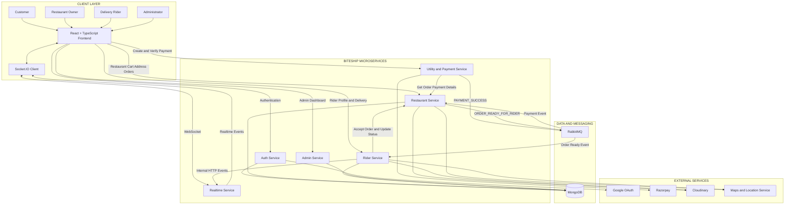

---

## 🔄 High-Level Request Flow

```mermaid
flowchart LR

    A["User"] --> B["React Frontend"]

    B --> C["Authenticate"]
    C --> D["JWT"]

    D --> E["Browse Restaurants"]
    E --> F["Add Items to Cart"]

    F --> G["Select Address"]

    G --> H["Create Order"]

    H --> I["Payment Service"]

    I --> J["Razorpay"]

    J --> K["PAYMENT_SUCCESS Event"]

    K --> L["Restaurant Service"]

    L --> M["Restaurant Accepts and Prepares"]

    M --> N["ORDER_READY_FOR_RIDER Event"]

    N --> O["Rider Service"]

    O --> P["Find Nearby Riders"]

    P --> Q["Realtime Service"]

    Q --> R["Rider Receives Order"]

    R --> S["Rider Accepts Delivery"]

    S --> T["Order Status Updates"]

    T --> U["Socket.IO Realtime Updates"]

    U --> A
```

---

## 🧠 Communication Model

| Communication | Technology | Used For |
|---|---|---|
| Client → Services | REST APIs | Normal request-response operations |
| Service → Service | Internal REST | Synchronous service communication |
| Service → Service | RabbitMQ | Asynchronous business events |
| Server → Client | Socket.IO | Realtime order and rider updates |
| Authentication | JWT | Stateless authentication |
| Location Search | MongoDB 2dsphere | Nearby restaurant/rider discovery |
| Payment | Razorpay | Payment creation and verification |
| Media | Cloudinary | Restaurant and rider image storage |

---

## ☁️ Current Deployment Architecture

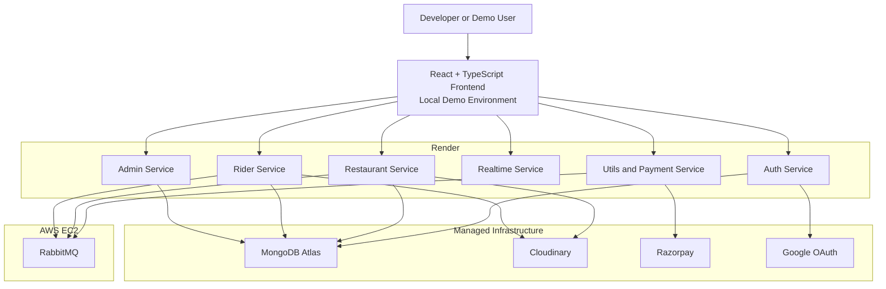

> **Deployment Note:** All six backend microservices and RabbitMQ infrastructure were deployed successfully for the project. The frontend was also attempted on Vercel, but the production frontend deployment was not retained because Google OAuth/CORS configuration caused cross-origin authentication issues. The project is therefore demonstrated using the frontend's working local environment while the backend distributed infrastructure remains deployed.

---

## 🎯 Architecture Principles Used

- **Service Isolation** — Auth, restaurant, payment, rider, realtime, and admin responsibilities are separated.
- **Event-Driven Processing** — Payment and rider-dispatch workflows use RabbitMQ instead of tightly coupling services.
- **Synchronous + Asynchronous Communication** — REST handles immediate operations while events handle background workflows.
- **Realtime by Design** — Socket.IO rooms provide targeted updates to customers, restaurants, and riders.
- **GeoSpatial Scalability** — MongoDB `2dsphere` indexes support proximity-based rider discovery.
- **Stateless Authentication** — JWT enables authentication across independently deployed services.
- **Independent Deployment** — Backend services can be deployed and scaled independently.

---

# 🔄 How the System Communicates

## 1. Synchronous Communication

The frontend communicates with backend services through REST APIs.

```text
Frontend
   │
   ├── HTTP ──► Auth Service
   ├── HTTP ──► Restaurant Service
   ├── HTTP ──► Payment Service
   ├── HTTP ──► Rider Service
   └── HTTP ──► Admin Service
```

Internal service-to-service communication is also used where an immediate response is required:

```text
Payment Service
       │
       │ Internal HTTP
       ▼
Restaurant Service
```

---

## 2. Asynchronous Communication

Time-consuming workflows are handled using RabbitMQ events.

```text
Payment Verified
       │
       ▼
Utils / Payment Service
       │
       │ PAYMENT_SUCCESS
       ▼
RabbitMQ
       │
       ▼
Restaurant Service
       │
       ▼
Order marked as paid
```

And for rider dispatch:

```text
Restaurant prepares order
          │
          ▼
Restaurant Service
          │
          │ ORDER_READY_FOR_RIDER
          ▼
RabbitMQ
          │
          ▼
Rider Service
          │
          │ Find nearby available riders
          ▼
Realtime Service
          │
          ▼
Rider receives Socket.IO event
```

---

## 3. Realtime Communication

```text
Rider Service
     │
     │ Internal authenticated HTTP
     ▼
Realtime Service
     │
     │ Socket.IO
     ▼
user:{riderId} room
     │
     ▼
Rider Dashboard
```

The realtime service authenticates Socket.IO connections using JWT and places connected users into dedicated rooms such as:

```text
user:{userId}
restaurant:{restaurantId}
```

This allows targeted event delivery instead of broadcasting every event to every connected user.

---

## 4. Deployment Architecture

```text
                    ┌─────────────────────────┐
                    │     React Frontend      │
                    │   Local Development     │
                    └────────────┬────────────┘
                                 │
                                 │ HTTPS / REST + Socket.IO
                                 ▼
              ┌─────────────────────────────────────┐
              │               Render                │
              │                                     │
              │  Auth Service                       │
              │  Restaurant Service                 │
              │  Utils / Payment Service            │
              │  Rider Service                      │
              │  Realtime Service                   │
              │  Admin Service                      │
              └───────────────┬─────────────────────┘
                              │
                    ┌─────────┴─────────┐
                    ▼                   ▼
          ┌────────────────┐    ┌────────────────┐
          │    MongoDB     │    │ AWS EC2        │
          │   BiteShip DB  │    │   RabbitMQ     │
          └────────────────┘    └────────────────┘
```

---

> **Architecture Summary:** BiteShip follows a distributed microservices architecture with six independently deployed backend services. REST APIs handle synchronous request-response operations, RabbitMQ handles asynchronous workflows such as payment confirmation and rider dispatch, Socket.IO provides targeted realtime communication, MongoDB stores application data with GeoSpatial indexing for location-based queries, and external providers handle authentication, payments, media storage, and location functionality.

# 🧠 Architecture Philosophy

BiteShip follows a **hybrid communication model**.

Different operations use different communication patterns depending on their requirements.

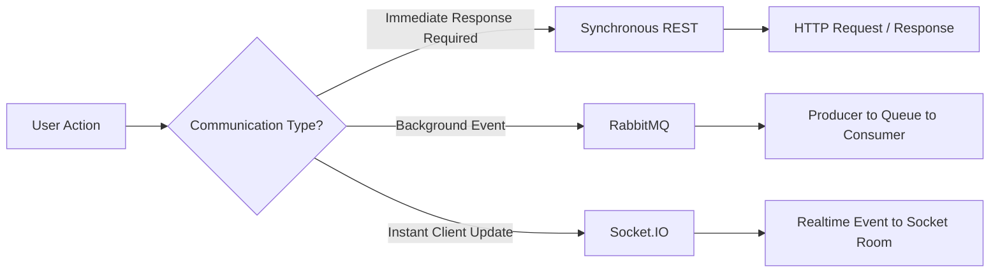

### 1. REST

Used when the caller requires an immediate response.

Examples:

```text
Frontend → Auth Service
Frontend → Restaurant Service
Frontend → Payment Service
Frontend → Rider Service
Frontend → Admin Service

Utils Service → Restaurant Service
Rider Service → Realtime Service
```

### 2. RabbitMQ

Used for asynchronous service-to-service events.

Examples:

```text
Payment Success
        │
        ▼
RabbitMQ
        │
        ▼
Order Payment Update


Order Ready For Rider
        │
        ▼
RabbitMQ
        │
        ▼
Rider Service
```

### 3. Socket.IO

Used for instant updates to connected clients.

Examples:

```text
New Delivery Request
Order Status Updated
Rider Location Updated
Restaurant Order Updates
```

---

# 🧩 Microservices

BiteShip currently consists of six backend services.

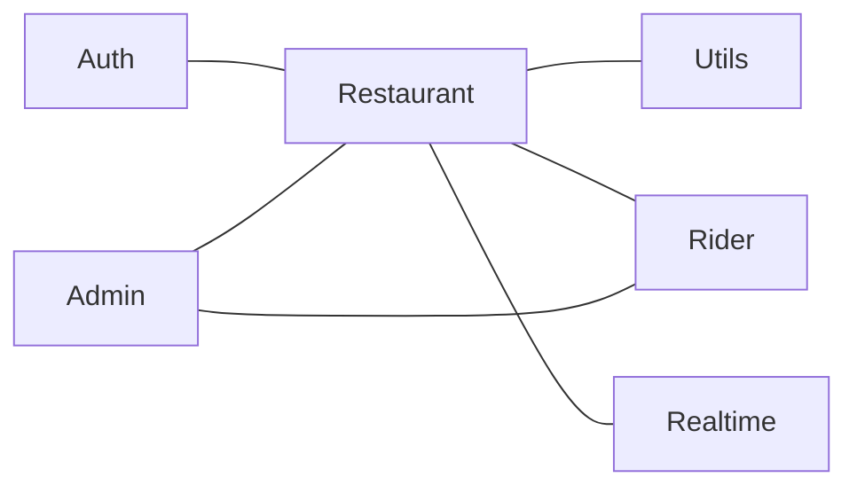

---

## 🔐 1. Authentication Service

Responsible for user identity and authentication.

### Responsibilities

- User registration
- User login
- Google authentication
- JWT generation
- Current user retrieval
- Role management

### Roles

```text
customer
seller
rider
admin
```

### Authentication Flow

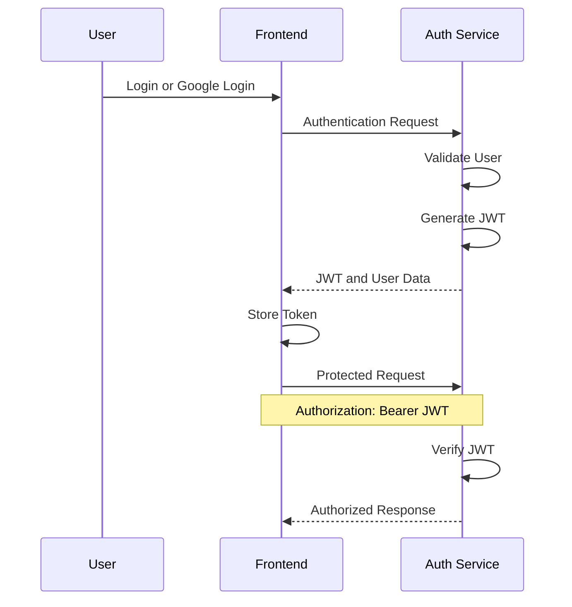

---

## 🍽️ 2. Restaurant Service

This is the primary business service responsible for the customer food ordering lifecycle.

### Main Modules

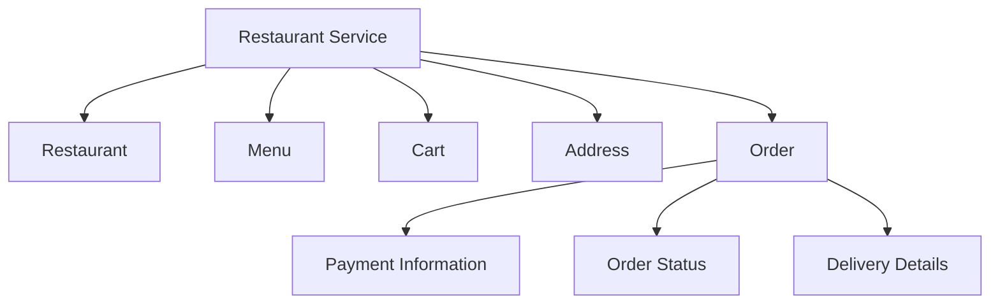

### Responsibilities

- Restaurant management
- Menu management
- Cart management
- Address management
- Order creation
- Order status management
- Restaurant order dashboard
- Rider assignment
- Payment order information

---

# 🛒 Cart Architecture

The cart ensures that a customer can order from only one restaurant at a time.

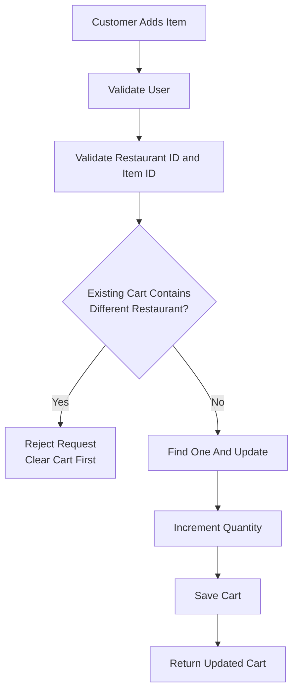

The cart uses a compound unique index.

```text
userId + restaurantId + itemId
```

This prevents duplicate cart documents for the same item.

---

# 📍 Address Architecture

Addresses are stored separately from the user authentication data.

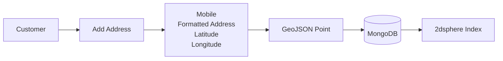

Location is stored in GeoJSON format.

```json
{
  "type": "Point",
  "coordinates": [
    longitude,
    latitude
  ]
}
```

---

# 📦 Order Architecture

The order stores a snapshot of important information.

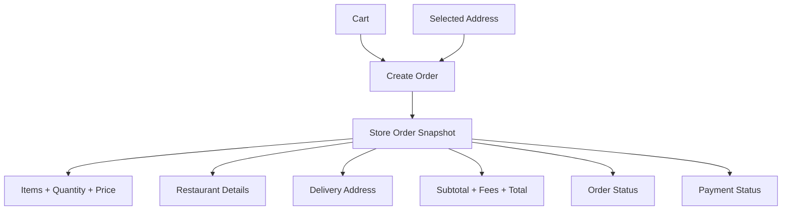

This avoids depending on future changes to menu items or restaurant data.

For example, if a menu item's price changes after an order is placed, the existing order still contains the original price.

---

# 📦 Complete Order Lifecycle

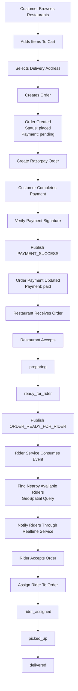

---

# 💳 Payment Architecture

The payment flow is isolated from the main restaurant service.

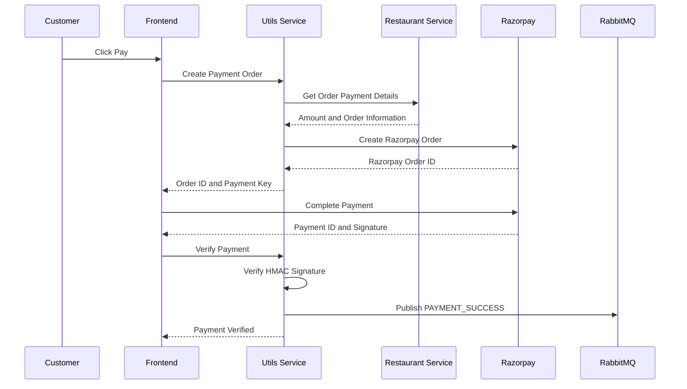

The payment service publishes an event instead of directly coupling payment completion with every downstream operation.

```text
PAYMENT_SUCCESS
```

This follows an event-driven approach.

---

# 🐇 RabbitMQ Event Architecture

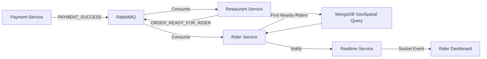

---

# 🚴 Rider Service Architecture

The rider service handles the complete delivery partner workflow.

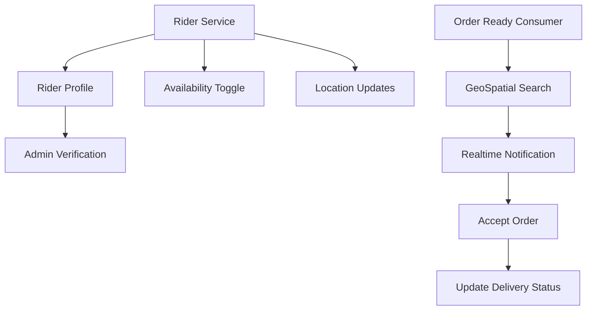

---

# 🌍 GeoSpatial Rider Discovery

MongoDB GeoSpatial indexing is used to find riders near the restaurant.

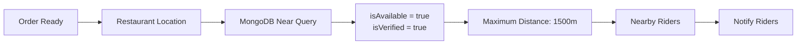

Conceptually:

```text
Find riders where:

✓ Rider is verified
✓ Rider is available
✓ Rider is geographically near the restaurant
✓ Rider location is inside the configured radius
```

The Rider collection uses:

```text
2dsphere index
```

for geospatial queries.

---

# ⚡ Realtime Architecture

The realtime service acts as a dedicated Socket.IO gateway.

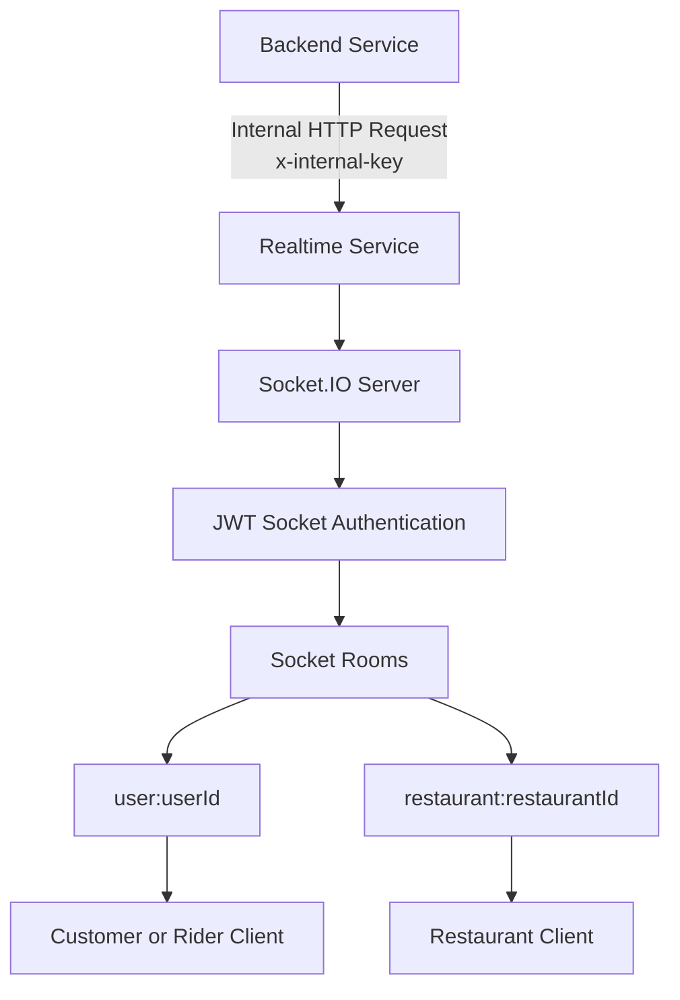

Services do not need to directly manage Socket.IO connections.

Instead:

```text
Backend Service
      │
      ▼
Realtime Internal API
      │
      ▼
Realtime Service
      │
      ▼
Socket.IO Room
      │
      ▼
Connected Client
```

Example:

```json
{
  "event": "order:available",
  "room": "user:riderUserId",
  "payload": {
    "orderId": "123",
    "restaurantId": "456"
  }
}
```

---

# 🔌 Socket Authentication

Socket connections are authenticated using JWT.

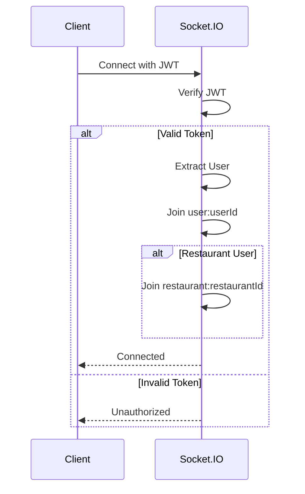

This allows targeted events instead of broadcasting every event to every connected user.

---

# 🛡️ Admin Service Architecture

The admin service is responsible for platform-level operations.

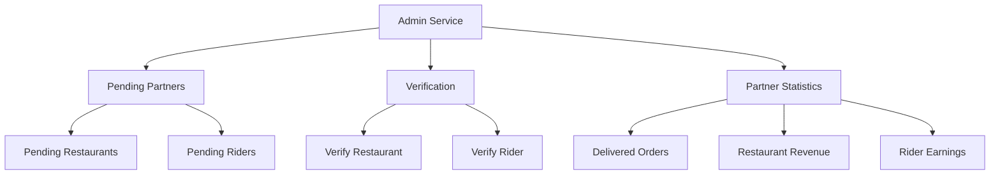

---

# 🏪 Restaurant Verification Flow

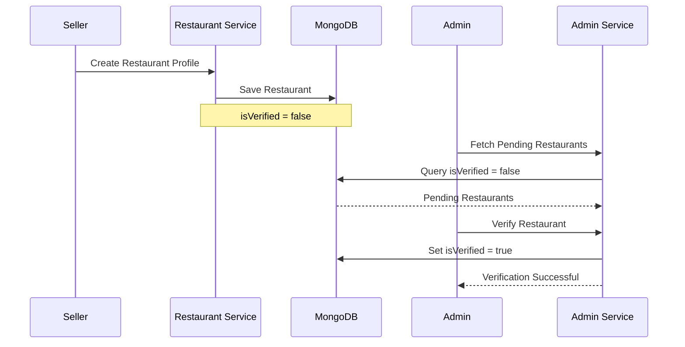

---

# 🚴 Rider Verification Flow

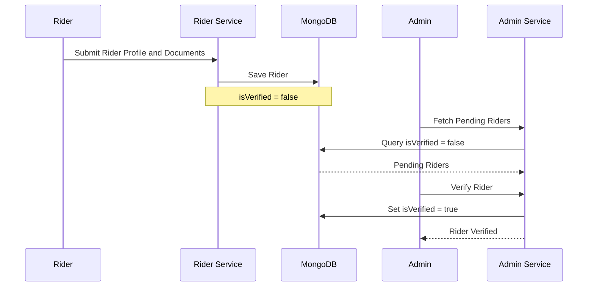

---

# 🧱 Data Architecture

The project uses MongoDB as the primary data store.

```mermaid
flowchart LR

    MONGO_DATA["MongoDB"]

    MONGO_DATA --> USERS["users"]
    MONGO_DATA --> RESTAURANTS["restaurants"]
    MONGO_DATA --> MENU["menuitems"]
    MONGO_DATA --> CARTS["carts"]
    MONGO_DATA --> ADDRESSES["addresses"]
    MONGO_DATA --> ORDERS_COLLECTION["orders"]
    MONGO_DATA --> RIDERS_COLLECTION["riders"]
```

### Important Collections

| Collection | Purpose |
|---|---|
| `users` | Authentication and user roles |
| `restaurants` | Restaurant profiles |
| `menuitems` | Restaurant menu items |
| `carts` | Customer cart items |
| `addresses` | Customer delivery addresses |
| `orders` | Order lifecycle and payment data |
| `riders` | Rider profiles, availability, verification and location |

---

# 📊 Order State Machine

```mermaid
stateDiagram-v2

    [*] --> placed

    placed --> accepted
    accepted --> preparing
    preparing --> ready_for_rider

    ready_for_rider --> rider_assigned

    rider_assigned --> picked_up

    picked_up --> delivered

    placed --> cancelled
    accepted --> cancelled
```

### Order States

```text
placed
accepted
preparing
ready_for_rider
rider_assigned
picked_up
delivered
cancelled
```

---

# 💰 Payment State Machine

```mermaid
stateDiagram-v2

    [*] --> pending

    pending --> paid
    pending --> failed
```

### Payment States

```text
pending
paid
failed
```

---

# 🔐 Security Design

BiteShip uses multiple layers of authentication and authorization.

```mermaid
flowchart TB

    REQUEST["Incoming Request"]

    REQUEST --> JWT["JWT Validation"]

    JWT --> VALID{"Valid Token?"}

    VALID -->|No| DENY["401 Unauthorized"]

    VALID -->|Yes| USER_EXTRACT["Extract User"]

    USER_EXTRACT --> ROLE["Role Validation"]

    ROLE --> ALLOW{"Authorized?"}

    ALLOW -->|No| FORBIDDEN["403 Unauthorized"]

    ALLOW -->|Yes| CONTROLLER["Business Logic"]
```

### Security Mechanisms

- JWT-based authentication
- Role-based authorization
- Protected REST APIs
- Socket JWT authentication
- Internal service key for private service-to-service APIs
- Payment signature verification using HMAC SHA256
- MongoDB validation
- Geospatial index-based rider discovery

---

# 🔄 Service Communication Matrix

| Source | Destination | Communication | Purpose |
|---|---|---|---|
| Frontend | Auth Service | REST | Authentication |
| Frontend | Restaurant Service | REST | Restaurants, Cart, Address, Orders |
| Frontend | Utils Service | REST | Payment |
| Frontend | Rider Service | REST | Rider workflow |
| Frontend | Admin Service | REST | Admin dashboard |
| Frontend | Realtime Service | Socket.IO | Live updates |
| Utils Service | Restaurant Service | Internal REST | Fetch payment amount |
| Utils Service | RabbitMQ | Event | Payment success |
| Restaurant Service | RabbitMQ | Event | Order ready |
| RabbitMQ | Rider Service | Consumer | Rider dispatch |
| Rider Service | Realtime Service | Internal REST | Emit rider event |
| Realtime Service | Frontend | Socket.IO | Realtime delivery events |
| Admin Service | MongoDB | Direct DB Access | Verification and statistics |

---

# 🏃 Happy Path: Complete Customer Order Flow

```mermaid
sequenceDiagram

    autonumber

    participant C as Customer
    participant F as Frontend
    participant R as Restaurant Service
    participant P as Payment Service
    participant RP as Razorpay
    participant MQ as RabbitMQ
    participant RD as Rider Service
    participant RT as Realtime Service
    participant DB as MongoDB

    C->>F: Browse Restaurants
    F->>R: Fetch Restaurants
    R->>DB: Query Restaurants
    DB-->>R: Restaurant Data
    R-->>F: Display Restaurants

    C->>F: Add Item To Cart
    F->>R: Add To Cart
    R->>DB: Upsert Cart Item
    DB-->>R: Updated Cart
    R-->>F: Cart Updated

    C->>F: Select Address
    F->>R: Fetch or Add Address
    R->>DB: Save Address
    DB-->>R: Address
    R-->>F: Address Selected

    C->>F: Place Order
    F->>R: Create Order
    R->>DB: Create Order
    DB-->>R: Order Created
    R-->>F: Order ID

    C->>F: Pay
    F->>P: Create Payment
    P->>R: Get Order Amount
    R-->>P: Amount
    P->>RP: Create Razorpay Order
    RP-->>P: Payment Order
    P-->>F: Razorpay Details

    F->>RP: Complete Payment
    RP-->>F: Payment Response

    F->>P: Verify Payment
    P->>P: Verify Signature

    P->>MQ: PAYMENT_SUCCESS

    MQ->>R: Consume Payment Event

    R->>DB: Mark Payment Paid

    R->>R: Restaurant Accepts Order

    R->>R: Order Preparing

    R->>MQ: ORDER_READY_FOR_RIDER

    MQ->>RD: Consume Order Ready Event

    RD->>DB: Find Nearby Available Riders

    DB-->>RD: Nearby Riders

    RD->>RT: Emit order:available

    RT-->>F: Realtime Rider Notification

    C->>F: Rider Accepts Order

    F->>RD: Accept Order

    RD->>R: Assign Rider

    R->>DB: Update Order

    RD->>RT: Emit Order Update

    RT-->>F: Realtime Status Update

    RD->>R: Update Delivery Status

    R->>DB: picked_up to delivered

    R-->>F: Delivery Completed
```

---

# ⚙️ Technology Stack

## Frontend

```text
React.js
TypeScript
Tailwind CSS
Axios
React Router
React Hot Toast
Socket.IO Client
```

## Backend

```text
Node.js
Express.js
TypeScript
JWT
Mongoose
MongoDB Driver
Multer
Axios
```

## Distributed Systems

```text
RabbitMQ
Socket.IO
REST APIs
Event-Driven Architecture
Microservices
```

## Database

```text
MongoDB
Mongoose
MongoDB GeoSpatial Queries
2dsphere Index
```

## External Services

```text
Razorpay
Google Authentication
Cloudinary
OpenStreetMap / Nominatim
```

---

# 📁 High-Level Project Structure

```text
BiteShip
│
├── auth-service
│   └── Authentication and JWT
│
├── restaurant-service
│   ├── Restaurant
│   ├── Menu
│   ├── Cart
│   ├── Address
│   └── Orders
│
├── utils-service
│   ├── Razorpay
│   ├── Payment Verification
│   └── RabbitMQ Payment Producer
│
├── realtime-service
│   ├── Socket.IO
│   ├── JWT Socket Authentication
│   └── Internal Event API
│
├── rider-service
│   ├── Rider Profiles
│   ├── GeoSpatial Queries
│   ├── Availability
│   ├── Order Consumer
│   └── Delivery Workflow
│
├── admin-service
│   ├── Restaurant Verification
│   ├── Rider Verification
│   └── Partner Statistics
│
├── frontend
│   ├── Customer Pages
│   ├── Restaurant Dashboard
│   ├── Rider Dashboard
│   └── Admin Dashboard
│
└── docs
    ├── architecture
    │   ├── hld.md
    │   ├── lld.md
    │   └── system-design.md
    │
    ├── workflows
    │   ├── order-lifecycle.md
    │   └── realtime-architecture.md
    │
    └── deployment
        └── deployment-guide.md
```

---

# ☁️ Deployment Architecture

Backend services were deployed independently.

```mermaid
flowchart TB

    USER_DEPLOY["Users"]

    USER_DEPLOY --> INTERNET["Internet"]

    INTERNET --> RENDER["Render"]

    RENDER --> AUTH_RENDER["Auth Service"]
    RENDER --> REST_RENDER["Restaurant Service"]
    RENDER --> UTILS_RENDER["Utils Service"]
    RENDER --> REALTIME_RENDER["Realtime Service"]
    RENDER --> RIDER_RENDER["Rider Service"]
    RENDER --> ADMIN_RENDER["Admin Service"]

    AUTH_RENDER --> MONGO_RENDER["MongoDB Atlas"]
    REST_RENDER --> MONGO_RENDER
    RIDER_RENDER --> MONGO_RENDER
    ADMIN_RENDER --> MONGO_RENDER

    UTILS_RENDER --> RAZORPAY_RENDER["Razorpay"]

    AUTH_RENDER --> GOOGLE_RENDER["Google OAuth"]

    REST_RENDER --> CLOUDINARY_RENDER["Cloudinary"]
    RIDER_RENDER --> CLOUDINARY_RENDER

    RENDER --> AWS_RENDER["AWS EC2"]

    AWS_RENDER --> RABBIT_RENDER["RabbitMQ"]
```

---

# 🌐 Service Deployment URLs

| Service | URL |
|---|---|
| Auth Service | `https://biteship-auth-xa00.onrender.com` |
| Restaurant Service | `https://biteship-restaurant.onrender.com` |
| Utils Service | `https://biteship-utils.onrender.com` |
| Realtime Service | `https://biteship-realtime.onrender.com` |
| Rider Service | `https://biteship-rider.onrender.com` |
| Admin Service | `https://biteship-admin.onrender.com` |

RabbitMQ is hosted separately on an AWS EC2 instance.

> The frontend was also deployed to Vercel during the project, but the deployed frontend is currently not used as the final production demo because Google authentication caused deployment-side CORS/origin issues. The backend microservices, RabbitMQ infrastructure, MongoDB, and other backend integrations remain the primary deployed architecture.

---

# 🎯 Key System Design Decisions

## Why Microservices?

Different domains have different responsibilities.

```text
Authentication ≠ Orders ≠ Payments ≠ Riders ≠ Realtime ≠ Administration
```

Separating them makes the architecture easier to reason about and allows services to evolve independently.

---

## Why RabbitMQ?

Some operations do not require synchronous blocking communication.

For example:

```text
Payment Completed
       ↓
Publish Event
       ↓
Other Service Processes Event
```

This avoids tightly coupling payment completion directly to downstream business logic.

---

## Why Socket.IO?

Polling would repeatedly ask:

```text
Did my order status change?
Did my rider get assigned?
Where is my rider?
```

Instead, Socket.IO allows the server to push events immediately.

```text
Backend Event
      ↓
Socket.IO
      ↓
Connected Client
```

---

## Why GeoSpatial Queries?

Rider assignment depends on physical distance.

Instead of loading every rider and calculating distance manually:

```text
MongoDB
   │
   ├── 2dsphere Index
   │
   └── Near Query
          │
          ▼
    Nearby Available Riders
```

---

## Why Internal APIs?

Some endpoints should only be called by trusted backend services.

For example:

```text
Rider Service
      │
      │ x-internal-key
      ▼
Realtime Internal API
```

This separates internal service communication from public APIs.

---

# 🧪 Main User Roles

```mermaid
flowchart LR

    CUSTOMER["Customer"]
    SELLER["Seller"]
    RIDER_ROLE["Rider"]
    ADMIN_ROLE["Admin"]

    CUSTOMER --> C1["Browse Restaurants"]
    CUSTOMER --> C2["Cart"]
    CUSTOMER --> C3["Payment"]
    CUSTOMER --> C4["Track Order"]

    SELLER --> S1["Manage Restaurant"]
    SELLER --> S2["Manage Menu"]
    SELLER --> S3["Process Orders"]

    RIDER_ROLE --> R1["Toggle Availability"]
    RIDER_ROLE --> R2["Receive Orders"]
    RIDER_ROLE --> R3["Accept Delivery"]
    RIDER_ROLE --> R4["Update Delivery Status"]

    ADMIN_ROLE --> A1["Verify Restaurants"]
    ADMIN_ROLE --> A2["Verify Riders"]
    ADMIN_ROLE --> A3["View Platform Statistics"]
```

---

# 🏆 What This Project Demonstrates

BiteShip was built to demonstrate practical backend and distributed system concepts:

- Designing a **multi-service backend architecture**
- Separating business domains into independent services
- JWT-based stateless authentication
- Role-based authorization
- Synchronous REST communication
- Asynchronous event-driven communication with RabbitMQ
- Dedicated realtime infrastructure using Socket.IO
- GeoSpatial queries using MongoDB
- Payment verification using cryptographic signatures
- Event-driven rider dispatch
- Internal service authentication
- Order state management
- Admin verification workflows
- Independent cloud deployment of backend services

---

# 🔮 Future Improvements

The current project focuses on implementing the complete distributed workflow. Future production-level improvements could include:

```text
API Gateway
Centralized Service Discovery
Redis Caching
Rate Limiting
Distributed Tracing
Structured Logging
Dead Letter Queues
Retry Policies
Idempotent Event Consumers
Database-per-Service Isolation
Kubernetes Deployment
CI/CD Pipelines
Monitoring and Metrics
Prometheus + Grafana
Load Balancing
Notification Service
Recommendation System
Advanced Rider Assignment Algorithm
```

---

# 📚 Documentation

Detailed project documentation is available inside:

```text
docs/
```

### Architecture

```text
docs/architecture/hld.md
docs/architecture/lld.md
docs/architecture/system-design.md
```

### Workflows

```text
docs/workflows/order-lifecycle.md
docs/workflows/realtime-architecture.md
```

### Deployment

```text
docs/deployment/deployment-guide.md
```

---

# 💡 Interview Explanation

> **BiteShip is a distributed food delivery platform designed using six backend services for authentication, restaurant and order management, payments, realtime communication, rider dispatch, and administration. I used synchronous REST calls where an immediate response was required and RabbitMQ for asynchronous business events such as payment completion and order-ready notifications. For realtime updates, I separated Socket.IO into its own service and used JWT-authenticated socket rooms. The rider service uses MongoDB GeoSpatial indexing to find nearby available riders, while the admin service handles partner verification and operational statistics.**

---

<div align="center">

###  BiteShip

**Built as a production-style exploration of microservices, event-driven architecture, realtime systems, payments, and geospatial delivery workflows.**

### Created by

**Chitra Khobe**  


⭐ If you found the architecture interesting, consider starring the repository.

</div>
